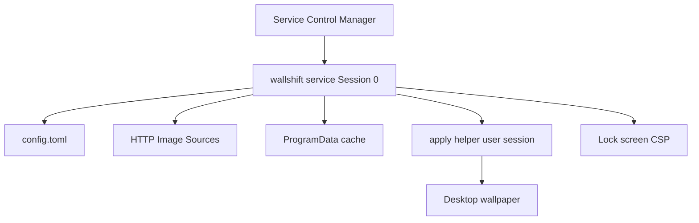

# 架构设计

## 系统概述

WallShift 由一个可执行文件承担三种角色：SCM 托管的服务进程、前台调试进程、用户会话中的 apply 助手。服务读取安装目录下的 `config\config.toml`，把图片落到同级 `cache`，再分别应用到桌面与锁屏。

## 技术栈

- Rust edition 2021
- `windows-service` 对接 SCM
- `windows` crate 调用 Win32
- `ureq` 下载图片
- `serde` + `toml` + `serde_json`

## 项目结构（建议）

```
src/main.rs          CLI 与角色分发
src/config.rs        TOML 加载与校验
src/state.rs         上次成功时间与轮询下标
src/download.rs      限体积流式下载与格式嗅探
src/scheduler.rs     双通道调度循环
src/apply.rs         壁纸 / 锁屏应用
src/service.rs       Windows 服务安装与托管
scripts/*.ps1        安装卸载辅助
```

## 核心模块/组件

- **Config loader**: 解析通道开关、间隔、图源，监视文件 mtime
- **Scheduler**: 到期则下载并 apply，失败保留旧图
- **Downloader**: 流式写入临时文件，magic bytes 识别 jpeg/png/bmp/webp
- **Session helper**: `WTSQueryUserToken` + `CreateProcessAsUserW`
- **Lock screen writer**: 写 `PersonalizationCSP` 并复制稳定路径

## 架构图



## 关键流程

1. SCM 启动 `wallshift.exe service`
2. 确保 ProgramData 目录与默认配置存在
3. 循环：热加载配置 -> 判断通道到期 -> 下载 -> 应用 -> 写 state
4. 壁纸应用：在活动控制台会话中启动 `apply wallpaper <file>`
5. 锁屏应用：服务进程写 HKLM 并复制文件
6. STOP 置位后 10 秒内退出循环

## 设计决策

- 同步 HTTP、无异步运行时，降低常驻内存
- 图片流式落盘，峰值内存与块大小相关而与整图无关
- 壁纸必须在用户会话执行；锁屏走机器策略，不依赖登录
- 配置热加载发生在每轮调度前，避免改文件后必须重启服务
