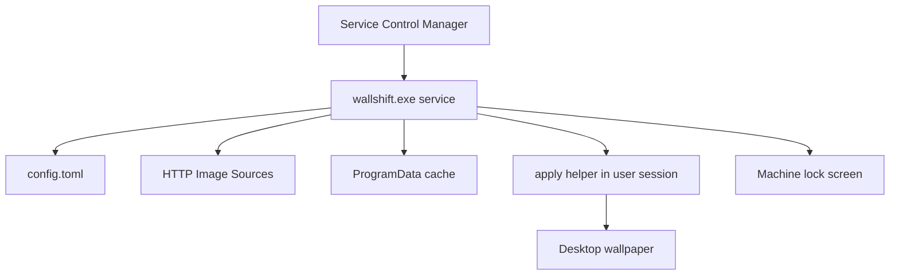

# WallShift

Feature Name: wallshift
Updated: 2026-10-28

## Description

WallShift 是一个 Rust 编写的 Windows 系统服务。服务以 LocalSystem 身份常驻，按 TOML 配置独立调度壁纸通道与锁屏通道：下载 HTTP(S) 图片、写入本地缓存，再把壁纸应用到当前控制台用户会话，把锁屏应用到机器级策略。

## Architecture



LocalSystem 运行在 Session 0。壁纸 API 必须在交互用户会话中调用，因此服务在下载完成后用 `CreateProcessAsUser` 拉起同一 exe 的 `--apply wallpaper` 短时进程。锁屏使用机器级注册表与 `LockScreenImage` 策略，由服务进程直接写入。

## Components and Interfaces

### Service host

- 使用 `windows-service` 注册 `WallShift`
- 子命令：`install` / `uninstall` / `run` / `once` / `apply`
- 停止事件通过 `SERVICE_STOP` 置位，主循环在 10 秒内退出

### Config loader

- 路径：安装目录下的 `config\config.toml`，可用 `--config` 覆盖
- 热加载：比较文件 `modified` 时间戳
- 校验：`interval_minutes >= 1`，`sources` 非空且为 http/https

### Scheduler

- 每 15 秒苏醒一次，分别判断两个通道是否到期
- 每个通道记录 `last_success_unix`
- 图源选择：`round-robin` 或 `random`

### Downloader

- `ureq` + rustls，超时 30 秒，体积上限 40 MiB
- 根据 magic bytes 识别 jpeg/png/bmp/webp，写入 `cache/wallpaper.bin` 或 `cache/lockscreen.bin`

### Wallpaper applier

- 用户会话中调用 `SystemParametersInfoW(SPI_SETDESKWALLPAPER)`
- 同步写入 `HKCU\Control Panel\Desktop` 的 `Wallpaper` 与 `WallpaperStyle`

### Lock screen applier

- 写入 `HKLM\SOFTWARE\Microsoft\Windows\CurrentVersion\PersonalizationCSP`
  - `LockScreenImagePath`
  - `LockScreenImageUrl`
  - `LockScreenImageStatus = 1`
- 复制一份到 `C:\Windows\Web\Screen\wallshift-lock.jpg` 作为稳定路径

### Session helper

- `WTSGetActiveConsoleSessionId` + `WTSQueryUserToken` + `CreateProcessAsUserW`
- 助手进程继承可执行文件路径，参数为 `apply wallpaper <file>`

## Data Models

```toml
[service]
cache_dir = "cache"

[wallpaper]
enabled = true
interval_minutes = 60
selection = "random"
sources = ["https://wp.upx8.com/api.php?resolution=3840x2160"]

[lockscreen]
enabled = true
interval_minutes = 120
selection = "random"
sources = ["https://wp.upx8.com/api.php?resolution=3840x2160"]
```

状态文件 `config\state.json`：

```json
{
  "wallpaper_last_success": 0,
  "lockscreen_last_success": 0,
  "wallpaper_index": 0,
  "lockscreen_index": 0
}
```

## Correctness Properties

- 两个通道的到期判断互不影响
- 下载失败保留上一张成功图片
- 配置解析失败继续使用内存中的上一份有效配置
- 服务停止时不杀死正在进行的 apply 助手，等待其自然退出或被超时回收
- 响应体超过 40 MiB 时中止写入并删除不完整文件

## Error Handling

| 场景 | 处理 |
|------|------|
| 配置缺失 | 首次启动写入默认配置 |
| 配置损坏 | 沿用旧配置 |
| 下载超时 / HTTP 非 2xx | 尝试下一条 source |
| 无活动用户会话 | 跳过壁纸应用，锁屏仍尝试机器级写入 |
| CreateProcessAsUser 失败 | 本轮壁纸失败，锁屏不受影响 |
| 磁盘满 | 保留旧缓存文件 |

## Test Strategy

- 配置解析：缺字段、非法 URL、interval=0
- 下载器：超大响应、非图片 Content-Type、magic bytes 不匹配
- 调度：壁纸 1 分钟、锁屏 2 分钟，验证独立触发
- 图源轮询：round-robin 越过失败项
- apply 子命令：对临时 bmp 调用壁纸 API 的路径拼接与参数构造（Windows 集成测试在目标机执行）

## References

[^1]: (Website) - [SystemParametersInfoW](https://learn.microsoft.com/windows/win32/api/winuser/nf-winuser-systemparametersinfow)
[^2]: (Website) - [PersonalizationCSP](https://learn.microsoft.com/windows/client-management/mdm/personalization-csp)
[^3]: (Website) - [WTSQueryUserToken](https://learn.microsoft.com/windows/win32/api/wtsapi32/nf-wtsapi32-wtsqueryusertoken)
